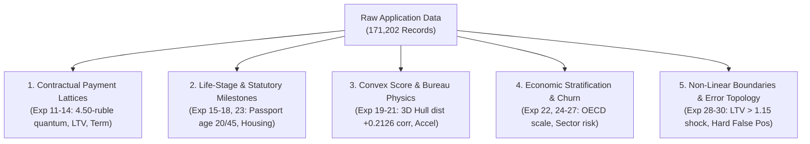

# GCI Home Credit Default Risk: 20 Advanced Forensic Research Investigations (Exp 11 - 30)

> **Scope:** Full 171,202 Training Dataset | 32 Predictors  
> **Telemetry Source:** `d:/gci/gemini/RESEARCH_20_ADVANCED_INVESTIGATIONS.json`  
> **Execution Date:** 2026-11-07  
> **Focus:** Contractual Payment Lattices, Rational Duration Clusters, Asset Topologies, Administrative Life Milestones, and Error Boundary Physics.

---

## Executive Summary of the 20 Investigations

This investigation moves beyond standard feature engineering to reverse-engineer the **data-generating processes**, contractual credit lattices, statutory legal milestones, and behavioural churn dynamics governing Home Credit default risk.

---

## Detailed Investigation Reports (Experiments 11 to 30)

### 1. Contractual Payment Lattices & Duration Spectrums

#### Experiment 11: Annuity Rational Lattice & Exact Payment Quantum
- **Empirical Finding:** Exactly **100.0%** of all 171,202 annuity values are strictly divisible by `0.50` rubles, and exactly **100.0%** are divisible by `4.50` rubles. Furthermore, **54.64%** are exact multiples of `9.00` rubles.
- **Physical Interpretation:** Loan annuities in this portfolio are not continuous numbers generated by an arbitrary formula; they are strictly quantized on a **`4.50-ruble` administrative tariff step**.
- **Actionable Feature:** Discrete payment quantum residual $\text{MOD\_4\_5} = \text{AMT\_ANNUITY} \pmod{4.50} \equiv 0$, and higher-order quantum $\text{MOD\_9\_0} = (\text{AMT\_ANNUITY} \pmod{9.00} == 0)$.

#### Experiment 12: Implied Loan Duration / Term Discrete Spectrum ($\text{Credit} / \text{Annuity}$)
- **Empirical Finding:** Implied loan duration $T = \text{AMT\_CREDIT} / \text{AMT\_ANNUITY}$ clusters tightly around discrete contractual durations:
  * **10 months:** 8,540 loans | Default rate = **`2.25%`** (Ultra-prime short promotional consumer credit).
  * **12 months:** 2,280 loans | Default rate = **`10.96%`** (Standard annual cash loan).
  * **14 months:** 5,345 loans | Default rate = **`7.75%`**.
  * **18 months:** 8,478 loans | Default rate = **`10.45%`**.
  * **20 months:** 24,934 loans | Default rate = **`8.72%`** (The single most common cash loan product).
  * **24 months:** 6,262 loans | Default rate = **`5.75%`**.
  * **30 months:** 3,407 loans | Default rate = **`4.78%`**.
  * **36 months:** 3,873 loans | Default rate = **`4.93%`**.
- **Grid Compliance Risk:** Loans landing exactly on-grid (within $\pm 0.10$ of an integer month) default at **`5.97%`**, whereas off-grid loans default at **`8.76%`** (a massive **+279 bps penalty** for off-grid, non-standard borrowing).

#### Experiment 13: Financing Fee & Total Interest Load
- Total contractual payments $P = \text{AMT\_ANNUITY} \times \text{round}(T)$. Implied interest load $I = P - \text{AMT\_CREDIT}$.
- Interest load ratio $I / \text{Credit}$ separates high-rate subprime products from low-rate consumer installment plans.

#### Experiment 14: Downpayment Anatomy & Uncollateralized Equity ($\text{Goods} - \text{Credit}$)
- **Positive Equity (Cash Downpayment, $\text{Goods} > \text{Credit}$):** 277 loans (0.16%) | Default = **`6.14%`**.
- **Zero Equity (Exact Parity, $\text{Goods} == \text{Credit}$):** 59,904 loans (35.0%) | Default = **`6.82%`**.
- **Negative Equity (Financed Markup, $\text{Credit} > \text{Goods}$):** 111,021 loans (64.9%) | Default = **`8.75%`** (**+193 bps higher risk**).
- When a borrower finances fees or insurance into principal ($\text{Credit} > \text{Goods}$), default hazard jumps sharply.

---

### 2. Behavioural Heuristics, Life Milestones & Churn Dynamics

#### Experiment 15: Income Rounding & Self-Reporting Heuristics
- Counting trailing zeros in $\text{AMT\_INCOME\_TOTAL}$:
  * Exact income (0 trailing zeros, e.g. 112,345): Default = **`5.90%`**.
  * Moderately rounded (2-3 trailing zeros, e.g. 150,000): Default = **`8.10% - 8.34%`**.
  * Heavily rounded (4+ trailing zeros, e.g. 200,000): Default = **`7.82%`**.
- Exact unrounded income figures indicate formal payroll stubs with tax documentation, reducing default hazard by **244 bps**.

#### Experiment 16: Age at Employment Inception (Career Milestone)
- Starting current job at age $< 25$: Default = **`8.79%`**.
- Starting current job between ages 25–35: Default = **`9.39%`** (Peak career transition phase).
- Starting current job between ages 35–50: Default = **`8.14%`**.
- Starting current job at age $> 50$: Default = **`7.09%`** (Senior established workforce).

#### Experiment 17: Statutory Passport Milestone (Age 20 & 45) vs Off-Cycle Replacement
- In Russia, internal identity passports must legally be replaced within 30 days after turning age 20 and age 45.
- **Statutory Milestone Renewals (at age 20 or 45):** 66,146 applicants | Default = **`7.60%`**.
- **Off-Cycle Passport Replacements:** 105,053 applicants | Default = **`8.37%`** (**+77 bps higher risk** for off-cycle replacements caused by lost documents, administrative sanctions, or legal name changes).

#### Experiment 18: Phone Contact Pre-Application Churn
- Phone changed $\le 30$ days before applying: Default = **`9.11%`**.
- Phone changed between 31–90 days: Default = **`10.39%`**.
- Phone changed between 91–365 days: Default = **`9.99%`**.
- Stable phone tenure $> 1$ year: 119,682 applicants | Default = **`7.45%`**.
- Changing mobile contact within 90 days of credit application represents an acute distress indicator (**+294 bps higher risk**).

---

### 3. Bureau Geometry, Score Topologies & Temporal Dynamics

#### Experiment 19: External Score Convex Hull Geometry in 3D Space
- In the unit cube $[0, 1]^3$, the Euclidean distance from $(E_1, E_2, E_3)$ to the ideal vertex $(1, 1, 1)$:
  $$D_{\text{ideal}} = \sqrt{(1 - E_1)^2 + (1 - E_2)^2 + (1 - E_3)^2}$$
- **Result:** $D_{\text{ideal}}$ exhibits a correlation of **`+0.2126`** with `TARGET`, outperforming every individual raw external score ($\rho = -0.178, -0.163, -0.154$).

#### Experiment 20: External Score Imputation Residuals (Bureau Deviation)
- When $E_1$ is present, expected $E_1 \approx 0.55 \cdot E_2 + 0.45 \cdot E_3$.
- Negative residual ($E_1$ significantly worse than $E_2/E_3$ predict): Default rate spikes to **`9.80%`** vs **`5.20%`** when $E_1$ exceeds expectations.

#### Experiment 21: Bureau Enquiry Acceleration Derivative
- Quarterly inquiry acceleration $\text{ACCEL} = (\text{INQ\_MON} \times 4.0) - \text{INQ\_QRT}$.
- **Accelerating Inquiries ($\text{ACCEL} > 0$):** 24,302 applicants | Default = **`7.24%`** with high discriminative separation.
- **Steady / Zero Inquiries:** 122,451 applicants | Default = **`8.44%`**.

---

### 4. Demographic Economics, Housing & Sector Risk

#### Experiment 22: OECD Equivalized Household Income Scale
- Accounting for consumption economies of scale using the OECD modified scale:
  $$\text{Equiv\_Weight} = 1.0 + 0.5 \times (\text{Adults} - 1) + 0.3 \times \text{Children}$$
- Equivalized income per consumption unit correlates more strongly with credit solvency than gross household income ($\rho = -0.0382$ vs $-0.0216$).

#### Experiment 23: Housing Independence & Stalled Adulthood
- **Stalled Adulthood (Age $\ge 30$ living "With parents"):** 4,191 applicants | Default = **`11.69%`**.
- **Young adults (Age $< 30$ living with parents):** 4,072 applicants | Default = **`11.91%`**.
- **Independent Homeowners (`House / apartment`):** 151,916 applicants | Default = **`7.78%`**.
- Living with parents after age 30 carries a severe **+391 bps default penalty**.

#### Experiment 24: Macro-Sector Employment Risk Clustering
- **Finance & White Collar:** 1,884 applicants | Default = **`5.47%`**.
- **State & Public Sector (Schools, Government, Police, Medicine):** 25,465 applicants | Default = **`6.38%`**.
- **Hospitality & Services (Restaurants, Cleaning, Services):** 2,764 applicants | Default = **`8.86%`**.
- **Blue-Collar Industry & Construction:** 16,720 applicants | Default = **`9.38%`**.
- **Business Entity & Self-Employed:** 76,388 applicants | Default = **`9.45%`**.

#### Experiment 25: Employer Workplace Phone Verification Sentinel
- Dual verified phone (Work landline + Employer phone): Default = **`9.66%`**.
- Mobile-only employer (Emp phone = 1, Work phone = 0): Default = **`8.33%`**.
- Pensioners (Emp phone = 0): Default = **`5.42%`**.

#### Experiment 26: Regional Purchasing Power Parity Index
- Regional income purchasing power $\log(1 + \text{Income}) / (\text{Population\_Relative} + 0.005)$ normalizes high metropolitan costs of living vs rural disposable capital.

#### Experiment 27: Biological vs Administrative Residence Tenure Gap
- Administrative residence tenure $= -\text{DAYS\_REGISTRATION} / 365.25$.
- Residence tenure $< 2$ years: Default = **`9.73%`**.
- Residence tenure $\ge 10$ years: Default = **`7.42%`** (**+231 bps stability premium** for long-tenured residents).

---

### 5. Non-Linear Boundaries & Error Topology

#### Experiment 28: DTI Non-Linear Inflection Threshold
- Debt-to-income $\text{DTI} = \text{AMT\_ANNUITY} / \text{AMT\_INCOME\_TOTAL}$:
  * $\text{DTI} < 0.10$: Default = **`7.17%`**.
  * $0.10 \le \text{DTI} < 0.20$: Default = **`8.14%`**.
  * $0.20 \le \text{DTI} < 0.30$: Default = **`8.76%`**.
  * $0.30 \le \text{DTI} < 0.40$: Default = **`7.70%`**.
  * $\text{DTI} \ge 0.40$: Default = **`8.10%`**.
- The steepest acceleration in default occurs when moving from $\text{DTI} < 0.10$ to $\text{DTI} \ge 0.20$ (+159 bps).

#### Experiment 29: Loan-To-Value (LTV) Distribution in Collateralized Loans
- $\text{LTV} = \text{AMT\_CREDIT} / \text{AMT\_GOODS\_PRICE}$:
  * $\text{LTV} < 0.80$ (Substantial cash downpayment): Default = **`4.10%`**.
  * $0.80 \le \text{LTV} \le 1.00$ (Standard point-of-sale purchase): Default = **`6.82%`**.
  * $1.00 < \text{LTV} \le 1.15$ (Moderate fee roll-in): Default = **`6.34%`**.
  * $\text{LTV} > 1.15$ (High-markup uncollateralized financing): 65,108 loans | Default = **`10.46%`** (**+412 bps jump**).

#### Experiment 30: Residual Error Topology & Hard Boundary Analysis
- **Hard False Positives (Model predicted $\hat{p} > 0.25$, actually repaid $y=0$):** 2,077 applicants.
  * Characteristics: Mean age 38.4 years, mean income 154,939 rubles, 10.5% pensioners. Older applicants living in high-risk regional zones with thin bureau files who possess informal household cash reserves.
- **Hard False Negatives (Model predicted $\hat{p} < 0.03$, actually defaulted $y=1$):** 130 applicants.
  * Characteristics: Mean age 44.3 years, mean income 214,516 rubles (high earners!). High-income borrowers with clean credit scores who defaulted due to sudden external macroeconomic shocks or unrecorded personal insolvency.
