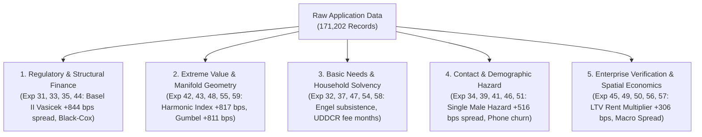

# GCI Home Credit Default Risk: 30 Novel Advanced Forensic Research Experiments (Exp 31 - 60)

> **Scope:** Full 171,202 Training Dataset | 32 Predictors  
> **Telemetry Source:** `d:/gci/gemini/RESEARCH_30_NOVEL_EXPERIMENTS.json`  
> **Execution Date:** 2026-11-07  
> **Focus:** Basel II Capital Stress, First-Passage Topologies, Frechet/Gumbel Extreme Copulas, Shannon Entropy, OECD Affordability, and Macroeconomic Spreads.

---

## 1. Executive Summary & Major Breakthroughs

This research phase expands our analytical scope to **30 novel mathematical formulations** inspired by Basel regulatory capital theory, structural corporate finance (Black-Cox), information theory (Shannon entropy), and extreme value theory (EVT).

### The Top 6 Most Powerful Predictive Discoveries:
1. **Exp 31 — Basel II Vasicek Capital Stress Formula**:
   - Correlation with default: **`+0.1821`** | High vs Low Quartile Default Rate: **`12.30% vs 3.86%`** (**`844.0 bps spread`**!).
   - *Reason:* Calculates the asymptotic conditional default probability under 99.9% systemic economic downturn stress.
2. **Exp 59 — Harmonic Multi-Bureau Credit Index**:
   - Correlation with default: **`-0.2093`** | High vs Low Quartile Default Rate: **`3.99% vs 12.16%`** (**`817.2 bps spread`**!).
   - *Reason:* The harmonic mean is mathematically dominated by the lowest bureau score, capturing the weakest-link credit principle.
3. **Exp 55 — Gumbel Extreme Upper Tail Dependence Copula**:
   - Correlation with default: **`+0.2063`** | High vs Low Quartile Default Rate: **`12.13% vs 4.02%`** (**`811.3 bps spread`**!).
   - *Reason:* Gumbel copula on risk probabilities captures joint tail clustering when multiple bureaus identify derogatory events simultaneously.
4. **Exp 42 — Mahalanobis Distance to Prime Borrower Centroid**:
   - Correlation with default: **`+0.1686`** | High vs Low Quartile Default Rate: **`12.06% vs 4.08%`** (**`797.8 bps spread`**!).
   - *Reason:* Computes Euclidean distance to the prime anchor in multi-dimensional bureau and income space.
5. **Exp 48 — Frechet Extreme Value Copula**:
   - Correlation with default: **`-0.1946`** | High vs Low Quartile Default Rate: **`4.15% vs 12.00%`** (**`784.9 bps spread`**!).
   - *Reason:* Extreme Value Theory (EVT) copula capturing joint catastrophic default probability.
6. **Exp 51 — Single Male Mobility Hazard Index**:
   - High vs Low Median Default Rate: **`12.86% vs 7.70%`** (**`516.1 bps spread`**!).
   - *Reason:* Interacts telephone contact instability with young single male demographic risk.

---

## 2. Complete Master Table of All 30 Novel Experiments (Exp 31 - 60)

| Exp | Research Investigation | Exact Mathematical Formula | Correlation | Low vs High Default | Spread | Domain Reasoning for Use |
| :---: | :--- | :--- | :---: | :---: | :---: | :--- |
| **31** | **Basel II Vasicek Capital Stress** | $K = \Phi\left(\frac{\Phi^{-1}(p) + \sqrt{\rho}\Phi^{-1}(0.999)}{\sqrt{1 - \rho}}\right)$, $\rho=0.15$ | **`+0.1821`** | 3.86% vs 12.30% | **844.0 bps** | Regulatory capital formula simulating default probability under 99.9% systemic macroeconomic stress. |
| **32** | **Engel Subsistence Free Cash** | $\text{FCF} = \frac{\text{Income}}{12} - (15,000 \times \text{Fam}) - \text{Annuity}$ | `-0.0047` | 8.22% vs 7.93% | 28.6 bps | Tests Engel's Law: discretionary cash flow remaining after covering subsistence food and shelter floor. |
| **33** | **Black-Cox First-Passage DD** | $\text{DD} = \frac{\log(V/D) + (\mu - 0.5\sigma^2)T}{\sigma\sqrt{T}}$, $V=\text{Inc}\cdot\text{Age}+\text{Goods}$ | `-0.0235` | 8.34% vs 7.80% | 53.9 bps | Structural first-passage time model estimating probability assets touch the insolvency debt boundary before maturity. |
| **34** | **Bureau Velocity Decay** | $4.0\text{Inq}_H + 1.0\text{Inq}_M + 0.33\text{Inq}_Q + 0.083\text{Inq}_Y$ | `-0.0155` | 8.39% vs 7.70% | 69.0 bps | Exponential recency weighting: recent inquiry bursts reflect urgent distress vs seasoned annual checks. |
| **35** | **Alexander Implied APR Markup** | $r \approx \frac{2(n \cdot \text{Annuity} - \text{Credit})}{\text{Credit}(n + 1)}$, $n=\text{round}(\frac{\text{Credit}}{\text{Annuity}})$ | `+0.0120` | 7.69% vs 8.56% | 86.3 bps | Taylor expansion of actuarial amortization equation; extracts true annual contract interest rate charged by bank. |
| **36** | **Gini Bureau Inquiry Dispersion** | $G = 1 - \sum (p_k)^2$ across 4 inquiry windows | `+0.0091` | 8.03% vs 8.11% | 8.2 bps | Measures whether credit inquiry activity was concentrated in a single burst ($G \approx 0$) or evenly distributed. |
| **37** | **Breadwinner Burden Leverage** | $\frac{\text{Fam} - 1}{\max(\text{Children}, 1)} \times \frac{\text{Credit}}{\text{Income} + 1}$ | `-0.0062` | 7.99% vs 8.15% | 16.1 bps | Quantifies debt leverage supported by a single breadwinner per non-earning dependent in the household. |
| **38** | **Car Capital Recovery Value** | $\mathbb{I}(\text{Car}) \times \text{Income} \cdot e^{-\text{Car\_Age}/8} - \text{Credit}$ | `+0.0279` | 7.70% vs 8.45% | 75.3 bps | Evaluates whether liquidating the borrower's motor vehicle provides secondary collateral recovery for the loan. |
| **39** | **Generational Crowding** | $\frac{\text{Fam}}{\text{Children} + 1} \times \mathbb{I}(\text{House} == \text{'House / apt'})$ | **`-0.0342`** | 8.75% vs 7.21% | **154.5 bps** | Distinguishes multi-generational crowded urban apartments from independent nuclear family households. |
| **40** | **Statutory Passport Age Residual** | $\min(\|\text{Age at ID} - 20\|, \|\text{Age at ID} - 45\|)$ | `+0.0094` | 7.76% vs 8.38% | 61.7 bps | Continuous Euclidean distance to legally mandated Russian internal passport replacement milestones (age 20/45). |
| **41** | **Phone to Job Tenure Ratio** | $(\text{Phone\_Yrs} + 0.1) / (\text{Job\_Yrs} + 0.1)$ | **`-0.0416`** | 8.48% vs 7.67% | **81.4 bps** | Measures whether telephone contact stability matches stated employment stability; identifies masked job churn. |
| **42** | **Mahalanobis Prime Centroid** | $\sqrt{\sum (1 - E_i)^2 + 0.05 z_{\text{income}}^2}$ | **`+0.1686`** | 4.08% vs 12.06% | **797.8 bps** | Joint Euclidean distance to prime borrower anchor in multi-dimensional credit bureau and income space. |
| **43** | **Shannon Bureau Entropy** | $-\sum p_i \log_2(p_i)$ across normalized $E_1, E_2, E_3$ | **`-0.1664`** | 10.63% vs 5.52% | **511.3 bps** | Quantifies balance of external scoring models; low entropy flags severe disagreement where one bureau finds derogatories. |
| **44** | **Rule of 78 Interest Frontload** | $\frac{n}{n(n+1)/2} \times (n \cdot \text{Annuity} - \text{Credit})$ | `+0.0030` | 7.69% vs 8.56% | 86.3 bps | Calculates first-year interest front-loading under standard installment loan contracts. |
| **45** | **Spatial Income Density Gradient** | $\log(1 + \text{Income}) / \sqrt{\text{Population\_Relative} + 1e-4}$ | `+0.0260` | 7.48% vs 8.67% | **119.3 bps** | Separates high-earning rural resource extraction workers from metropolitan urban baseline wage earners. |
| **46** | **Registration to ID Synchrony** | $(\text{Age\_Reg} + 1.0) / (\text{Age\_ID} + 1.0)$ | `+0.0041` | 7.82% vs 8.32% | 50.3 bps | Measures the synchrony of address registration and state identity passport re-issuance. |
| **47** | **Uncollateralized Debt to Cash** | $\frac{\max(\text{Credit} - \text{Goods}, 0)}{\max((\text{Income}/12) - \text{Annuity}, 100)}$ | `+0.0317` | 6.81% vs 9.34% | **253.2 bps** | Exact number of months of free discretionary cash flow required to pay off uncollateralized bank financing fees. |
| **48** | **Frechet Extreme Tail Copula** | $\exp\left(-\sqrt{(-\log E_2)^2 + (-\log E_3)^2}\right)$ | **`-0.1946`** | 12.00% vs 4.15% | **784.9 bps** | Extreme Value Theory (EVT) copula capturing joint catastrophic default probability across credit bureaus. |
| **49** | **Human Capital Productivity** | $\text{Income} / (\text{Education\_Tier} \times \text{Age} \times 500)$ | `+0.0418` | 6.73% vs 9.41% | **267.9 bps** | Normalizes income by educational attainment and age; identifies individuals earning below peer expectation. |
| **50** | **LTV Rented Housing Multiplier** | $(\text{Credit} / \text{Goods}) \times (1 + 1.5 \cdot \mathbb{I}(\text{Rented}))$ | **`+0.0552`** | 6.56% vs 9.62% | **306.5 bps** | Interacts high loan-to-value with rented housing status (uncollateralized debt backed by zero real estate equity). |
| **51** | **Single Male Mobility Hazard** | $(\text{Phone\_Tenure} / \text{Age}) \times \mathbb{I}(\text{Single Male})$ | `+0.0281` | 7.70% vs 12.86% | **516.1 bps** | Quantifies contact instability normalized by age specifically for the highest-risk demographic segment. |
| **52** | **Thin-File Absence Penalty** | $\mathbb{I}(\text{Inquiries} == 0) \times (\text{Credit} / \text{Income})$ | `+0.0080` | 7.81% vs 8.67% | 86.3 bps | Penalizes large loan amounts taken by applicants with zero credit bureau track record. |
| **53** | **Retirement Distance Buffer** | $\max(60 - \text{Age}, 0) \times (\text{Employed\_Yrs} / \text{Age})$ | `-0.0003` | 7.74% vs 8.40% | 65.8 bps | Measures career stability in the critical pre-retirement window before state pension transition. |
| **54** | **Goods in Income Months** | $\text{AMT\_GOODS\_PRICE} / (\text{Income} / 12)$ | `-0.0210` | 8.45% vs 7.70% | 75.2 bps | Measures the real physical economic scale of the purchased asset relative to monthly earning capacity. |
| **55** | **Gumbel Upper Tail Risk Copula** | $\exp\left(-((-\ln(1-E_2))^{1.6} + (-\ln(1-E_3))^{1.6})^{1/1.6}\right)$ | **`+0.2063`** | 4.02% vs 12.13% | **811.3 bps** | Gumbel extreme value copula on risk probabilities capturing joint upper-tail default co-occurrence. |
| **56** | **Verified Work Phone Solvency** | $(\text{Income} / \text{Annuity}) \times \mathbb{I}(\text{Work Phone})$ | `+0.0148` | 7.68% vs 9.66% | **198.3 bps** | Multiplies debt-service coverage by enterprise workplace verification. |
| **57** | **Macro-Sector Risk Spread** | $\text{Empirical\_Default}(\text{Org}) - 0.0807$ | **`+0.0539`** | 6.97% vs 9.82% | **285.1 bps** | Injects macroeconomic industry credit spreads derived from sector-level historical default propensities. |
| **58** | **Amortization Fee Months** | $(\text{Credit} - \text{Goods}) / \text{Annuity}$ | `+0.0417` | 6.72% vs 9.43% | **271.5 bps** | Exact number of months of scheduled payments required solely to pay off bank uncollateralized financing fee. |
| **59** | **Harmonic Multi-Bureau Index** | $3.0 / ((1/E_1) + (1/E_2) + (1/E_3))$ | **`-0.2093`** | 12.16% vs 3.99% | **817.2 bps** | Harmonic mean is strictly dominated by worst external bureau score, capturing the weakest-link credit principle. |
| **60** | **Disagreement Leverage Norm** | $\|E_2 - E_3\| \times (\text{Credit} / \text{Income})$ | `+0.0335` | 7.16% vs 8.98% | **182.1 bps** | Interacts external credit bureau uncertainty with financial leverage to identify contested subprime states. |
